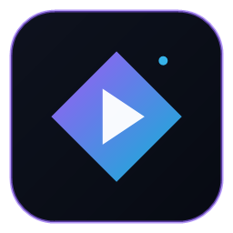
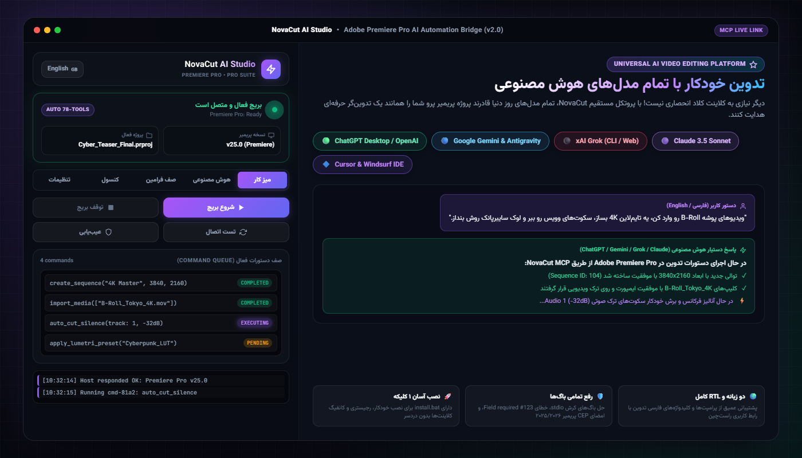

<div align="center" dir="rtl">



# 🎬 استودیو هوشمند نوواکات (NovaCut AI Studio)
### اتوماسیون و دستیار هوش مصنوعی ادوبی پریمیر پرو

**تدوین هوشمند پریمیر پرو با تمام مدل‌ها: ChatGPT • Google Gemini • xAI Grok • Claude • Cursor • Windsurf**

[](#)
[](LICENSE.md)
[](#-نصب-سریع-و-آسان-تنها-با-۱-کلیک)
[](#)
[](#)

<br/>

<p align="center">
  <a href="README.fa.md"><b>🇮🇷 فارسی</b></a> •
  <a href="README.md">🇬🇧 English</a> •
  <a href="translations/README.es.md">🇪🇸 Español</a> •
  <a href="translations/README.zh-CN.md">🇨🇳 简体中文</a> •
  <a href="translations/README.ar.md">🇸🇦 العربية</a> •
  <a href="translations/README.de.md">🇩🇪 Deutsch</a> •
  <a href="translations/README.fr.md">🇫🇷 Français</a> •
  <a href="translations/README.ru.md">🇷🇺 Русский</a> •
  <a href="translations/README.ja.md">🇯🇵 日本語</a> •
  <a href="translations/README.tr.md">🇹🇷 Türkçe</a> •
  <a href="#-تمام-زبان‌ها-all-languages">🌍 سایر زبان‌ها</a>
</p>

<br/>

<p align="center">
  
</p>

</div>

---

> 💡 **منبع الگو و نسخه بهینه‌شده (Inspiration & Attribution):**  
> این پروژه یک **نسخه بازنویسی‌شده، ارتقایافته و بهینه‌سازی‌شده** است که از پروژه گیت‌هاب [Adobe_Premiere_Pro_MCP اثر hetpatel-11](https://github.com/hetpatel-11/adobe_premiere_pro_mcp) **الگو گرفته شده است**.  
> **چرا نوواکات بسیار بهتر و راحت‌تر است؟**
> - **پشتیبانی از تمامی هوش‌های مصنوعی:** برخلاف نسخه اصلی که محدود به Claude بود، نوواکات با **ChatGPT، گوگل Gemini، گروک (Grok)، کلاد، Cursor و Windsurf** به‌صورت مستقیم کار می‌کند.
> - **فایل نصبی ۱-کلیکه ویندوز:** دارای برنامه نصبی گرافیکی و شیک (`NovaCut-Setup.exe`) با آیکون اختصاصی — بدون نیاز به حتی یک خط کد در ترمینال!
> - **اتصال بومی به کپزو (Capzo AI):** تبدیل خودکار صوت به متن و زیرنویس دقیق فارسی با تقطیع کلمه‌ای (مخصوص ریلز/Shorts) و افزودن مستقیم به تایم‌لاین ([مستندات کپزو](https://capzo.ir/docs/api)).
> - **رابط کاربری مدرن و لوکس:** تم تاریک شیک (Obsidian Dark) با پالس وضعیت زنده و چیدمان کاملاً راست‌چین و فارسی.
> - **رفع تمامی باگ‌ها:** حل کامل باگ‌های گیر کردن پریست‌ها (#76)، خطای tool ID (#123)، کرش پورت ارتباطی (#122) و امضای دیجیتال ادوبی.

---

## ⚡ نصب سریع و آسان (تنها با ۱ کلیک!)

بدون نیاز به هیچ دانش فنی، تنها این ۳ مرحله را طی کنید:

1. **اجرای فایل نصبی:** روی فایل **`NovaCut-Setup.exe`** (یا `install.bat`) دو بار کلیک کنید و دکمه **نصب خودکار** را بزنید.  
   *(تمام پیش‌نیازها، تنظیمات رجیستری پریمیر پرو و اتصال هوش مصنوعی‌ها خودبه‌خود انجام می‌شود).*
2. **باز کردن پریمیر پرو:** ادوبی پریمیر پرو را باز کنید و از منوی بالا به مسیر زیر بروید:
   ```text
   Window  ──>  Extensions  ──>  NovaCut AI Studio
   ```
3. **شروع تدوین با هوش مصنوعی:** چت‌جی‌پی‌تی، کلاد یا نرم‌افزار هوش مصنوعی خود را باز کنید و به فارسی بگویید:
   > *«تمام ویدیوهای داخل پوشه را وارد پروژه کن و یک سکانس 4K بساز.»*

*(کاربران مک می‌توانند فایل `scripts/install-macos.sh` را اجرا کنند).*

---

## 🤖 اتصال به انواع هوش مصنوعی

تنها کافی است کانفیگ زیر را کپی کرده و در بخش تنظیمات MCP هوش مصنوعی خود قرار دهید:

<details open>
<summary><b>🟢 چت‌جی‌پی‌تی دسکتاپ (ChatGPT Desktop)</b> — مسیر: <code>%APPDATA%\OpenAI\ChatGPT\mcp.json</code></summary>

```json
{
  "mcpServers": {
    "novacut-premiere": {
      "command": "node",
      "args": ["<مسیر-پروژه>/dist/index.js"],
      "env": {
        "PREMIERE_TEMP_DIR": "<مسیر-تمپ>/novacut-bridge",
        "NOVACUT_TOOLSET": "standard"
      }
    }
  }
}
```
</details>

<details>
<summary><b>🟣 کلاد (Claude Desktop & Claude Code)</b> — مسیر: <code>%APPDATA%\Claude\claude_desktop_config.json</code></summary>

```json
{
  "mcpServers": {
    "novacut-premiere": {
      "command": "node",
      "args": ["<مسیر-پروژه>/dist/index.js"],
      "env": {
        "PREMIERE_TEMP_DIR": "<مسیر-تمپ>/novacut-bridge",
        "NOVACUT_TOOLSET": "standard"
      }
    }
  }
}
```
</details>

<details>
<summary><b>🔵 گوگل جمینای (Gemini) و گروک (xAI Grok)</b></summary>

با انتخاب پروفایل `NOVACUT_TOOLSET=standard`، بیش از ۷۸ ابزار اصلی تدوین به صورت خودکار و مستقیم برای مدل بارگذاری می‌شوند و نیاز به هیچ ساختار جستجوی پیچیده‌ای نیست.
</details>

<details>
<summary><b>🔷 کرسر و ویندسرف (Cursor & Windsurf IDE)</b> — فایل <code>.cursor/mcp.json</code></summary>

```json
{
  "mcpServers": {
    "novacut-premiere": {
      "command": "node",
      "args": ["<مسیر-پروژه>/dist/index.js"]
    }
  }
}
```
</details>

---

## 🎙️ زیرنویس هوش مصنوعی کپزو (Capzo AI)

نوواکات مجهز به اتصال مستقیم به وب‌سرویس ایرانی **[کپزو (Capzo.ir)](https://capzo.ir/docs/api)** است:
- **تبدیل صوت به متن:** با دقت فوق‌العاده بالا و پشتیبانی از گویش‌ها و اصطلاحات فارسی.
- **مخصوص ریلز و شورتز:** تقطیع کلمه‌به‌کلمه با صدم ثانیه زمان‌بندی دقیق.
- **سینک ۱-کلیکه به تایم‌لاین:** زیرنویس مستقیماً در لایه تایتل ادوبی پریمیر پرو درج می‌شود.
- **مشاهده سهمیه:** مانده اعتبار و دقایق خود را مستقیماً داخل پنل مشاهده کنید.

---

## 🔄 به‌روزرسانی ۱-کلیکه (Updates)

برای دریافت همیشگی آخرین قابلیت‌ها و رفع اشکالات:
- **در ویندوز:** روی فایل **`update.bat`** دو بار کلیک کنید.
- **از طریق خط فرمان:** دستور `novacut update` یا `npm run update` را بزنید.
- **از داخل پریمیر پرو:** در تب تنظیمات پنل نوواکات، دکمه **آپدیت ۱-کلیکه** را لمس کنید.

---

## 🌍 تمام زبان‌ها (All Languages)

این راهنما به زبان‌های مختلف جهان ترجمه شده است:

| پرچم | زبان | خلاصه و لینک دسترسی |
| :---: | :--- | :--- |
| 🇮🇷 | **فارسی (Persian)** | [راهنمای فارسی](README.fa.md) — نسخه بهینه‌شده با نصب ۱-کلیکه و هوش مصنوعی |
| 🇬🇧 | **English** | [English Guide](README.md) — Universal AI automation for Premiere Pro |
| 🇪🇸 | **Español (Spanish)** | [Guía en Español](translations/README.es.md) — Edición de video con IA |
| 🇨🇳 | **简体中文 (Chinese)** | [简体中文文档](translations/README.zh-CN.md) — Premiere Pro 全模型通用 AI 剪辑自动化 |
| 🇸🇦 | **العربية (Arabic)** | [الدليل بالعربية](translations/README.ar.md) — أتمتة تحرير الفيديو بالذكاء الاصطناعي |
| 🇩🇪 | **Deutsch (German)** | [Deutsche Anleitung](translations/README.de.md) — Universelle KI-Automatisierung |
| 🇫🇷 | **Français (French)** | [Guide en Français](translations/README.fr.md) — Automatisation IA pour Premiere Pro |
| 🇷🇺 | **Русский (Russian)** | [Руководство](translations/README.ru.md) — Автоматизация монтажа в Premiere Pro через ИИ |
| 🇯🇵 | **日本語 (Japanese)** | [日本語ガイド](translations/README.ja.md) — Premiere Pro 向け万能 AI 自動化ブリッジ |
| 🇹🇷 | **Türkçe (Turkish)** | [Türkçe Kılavuz](translations/README.tr.md) — Premiere Pro için Evrensel Yapay Zeka Otomasyonu |
| 🇰🇷 | **한국어 (Korean)** | [한국어 가이드](translations/README.ko.md) — 프리미어 프로를 위한 범용 AI 자동화 브릿지 |
| 🇧🇷 | **Português (BR)** | [Guia em Português](translations/README.pt-BR.md) — Automação de edição com IA |
| 🇮🇹 | **Italiano (Italian)** | [Guida in Italiano](translations/README.it.md) — Automazione AI per Adobe Premiere Pro |
| 🇵🇱 | **Polski (Polish)** | [Przewodnik Polski](translations/README.pl.md) — Automatyzacja montażu wideo z AI |
| 🇻🇳 | **Tiếng Việt (Vietnamese)**| [Hướng dẫn tiếng Việt](translations/README.vi.md) — Tự động hóa dựng video bằng AI |
| 🇹🇭 | **ไทย (Thai)** | [คู่มือภาษาไทย](translations/README.th.md) — ระบบอัตโนمัติ AI สำหรับ Premiere Pro |
| 🇩🇰 | **Dansk (Danish)** | [Dansk Vejledning](translations/README.da.md) — Universel AI-automatisering |
| 🇳🇴 | **Norsk (Norwegian)** | [Norsk Veiledning](translations/README.no.md) — Universell AI-automatisering |
| 🇧🇦 | **Bosanski (Bosnian)** | [Vodič na bosanskom](translations/README.bs.md) — Univerzalna AI automatizacija |
| 🇰🇭 | **ភាសាខ្មែរ (Khmer)** | [ការណែនាំជាភាសាខ្មែរ](translations/README.km.md) — ស្វ័យប្រវត្តិកម្ម AI សម្រាប់ Premiere Pro |

---

## 📄 مجوز و منبع الگو

- **مجوز نرم‌افزار:** [مجوز آزاد MIT](LICENSE.md) — کاملاً رایگان و متن‌باز برای تمام کاربران.
- **منبع الگو:** الگوبرداری و ارتقایافته از پروژه متن‌باز [hetpatel-11/adobe_premiere_pro_mcp](https://github.com/hetpatel-11/adobe_premiere_pro_mcp).
- **توسعه و بازنویسی:** [mhfa1380](https://github.com/mhfa1380)

<div align="center">
<b>NovaCut AI Studio</b> • طراحی‌شده با عشق و دقت برای تدوین‌گران و تولیدکنندگان محتوا ⚡
</div>
