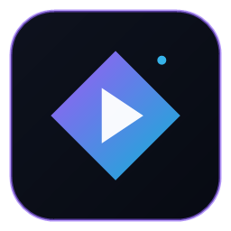
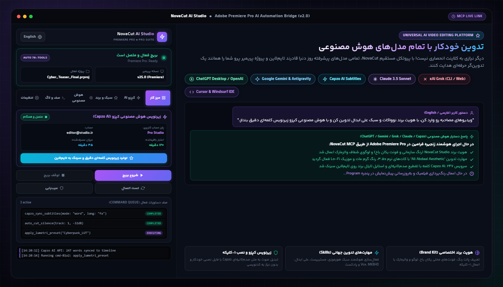

<div align="center">



# NovaCut AI Studio
### Universal AI Automation Bridge for Adobe Premiere Pro

**Control Premiere Pro with any AI: ChatGPT • Google Gemini • xAI Grok • Claude • Cursor • Windsurf**

[](#)
[](LICENSE.md)
[](#1-click-quick-start-windows)
[](#)
[](README.fa.md)

<br/>

<p align="center">
  <a href="README.fa.md">فارسی</a> •
  <a href="README.md"><b>English</b></a> •
  <a href="translations/README.es.md">Español</a> •
  <a href="translations/README.zh-CN.md">简体中文</a> •
  <a href="translations/README.ar.md">العربية</a> •
  <a href="translations/README.de.md">Deutsch</a> •
  <a href="translations/README.fr.md">Français</a> •
  <a href="translations/README.ru.md">Русский</a> •
  <a href="translations/README.ja.md">日本語</a> •
  <a href="translations/README.tr.md">Türkçe</a> •
  <a href="#all-languages">More Languages</a>
</p>

<br/>

<p align="center">
  
</p>

</div>

---

> **Attribution & Origin (منبع الگو و نسخه بهینه‌شده):**  
> NovaCut AI Studio is an **optimized, enhanced, and bug-free evolution inspired by** the open-source repository [Adobe_Premiere_Pro_MCP by hetpatel-11](https://github.com/hetpatel-11/adobe_premiere_pro_mcp).  
> **What makes NovaCut better?**
> - **Universal AI Support:** Works out-of-the-box with **ChatGPT, Gemini, Grok, Claude, Cursor, and Windsurf** (no longer limited to Claude).
> - **1-Click Graphical Installer:** Double-click `NovaCut-Setup.exe` with embedded icon and modern UI — zero technical setup required.
> - **Brand Identity Kit:** Enforce corporate color palettes, local typography (Yekan Bakh & Vazir), watermark overlays, and brand caption themes with 1 click.
> - **World-Class Editing Skills:** Built-in editing mastery engine featuring top creator styles: Hormozi (viral reels), MrBeast (retention king), Ali Abdaal (clean minimal), Vox (cinematic essay), MKBHD (studio tech), and Podcast Master.
> - **Capzo AI Subtitles Integration:** Native integration with [Capzo.ir](https://capzo.ir/docs/api) for automatic Persian speech-to-text and 1-click timeline subtitle sync.
> - **Luxury Minimal UI:** Sleek Obsidian dark theme with live radar beacon and Persian (RTL) / English bilingual support.
> - **Bug Fixes:** Solved modal hangs (#76), tool ID mismatch errors (#123), and stdio transport crashes (#122).

---

## 1-Click Quick Start (Windows)

No command line knowledge is required:

1. **Download & Run:** Double-click **`NovaCut-Setup.exe`** (or `install.bat`).  
   *It automatically installs the Premiere Pro extension, applies registry settings, and configures all your AI apps.*
2. **Open Premiere Pro:** Open your project, then go to:
   ```text
   Window  ──>  Extensions  ──>  NovaCut AI Studio
   ```
3. **Start Editing with AI:** Open ChatGPT, Claude, or Cursor and tell it:
   > *"Import all clips in my footage folder and create a 4K timeline."*

*macOS Users:* Run `./scripts/install-macos.sh` or run `npm run setup:mac`.

---

## AI Client Integrations

Copy the configuration below and paste it into your AI client's MCP configuration:

<details open>
<summary><b>ChatGPT Desktop / OpenAI MCP</b> (<code>%APPDATA%\OpenAI\ChatGPT\mcp.json</code>)</summary>

```json
{
  "mcpServers": {
    "novacut-premiere": {
      "command": "node",
      "args": ["<path-to-repo>/dist/index.js"],
      "env": {
        "PREMIERE_TEMP_DIR": "<path-to-temp>/novacut-bridge",
        "NOVACUT_TOOLSET": "standard"
      }
    }
  }
}
```
</details>

<details>
<summary><b>Claude Desktop / Claude Code</b> (<code>%APPDATA%\Claude\claude_desktop_config.json</code>)</summary>

```json
{
  "mcpServers": {
    "novacut-premiere": {
      "command": "node",
      "args": ["<path-to-repo>/dist/index.js"],
      "env": {
        "PREMIERE_TEMP_DIR": "<path-to-temp>/novacut-bridge",
        "NOVACUT_TOOLSET": "standard"
      }
    }
  }
}
```
</details>

<details>
<summary><b>Google Gemini / xAI Grok / Antigravity</b></summary>

Use the same standard MCP server command:
`node <path-to-repo>/dist/index.js` with `NOVACUT_TOOLSET=standard`.
78 essential editing tools are auto-exposed directly to the model.
</details>

<details>
<summary><b>Cursor & Windsurf IDE</b> (<code>.cursor/mcp.json</code>)</summary>

```json
{
  "mcpServers": {
    "novacut-premiere": {
      "command": "node",
      "args": ["<path-to-repo>/dist/index.js"]
    }
  }
}
```
</details>

---

## Brand Identity Kit

Never configure colors, fonts, or watermarks manually again:
- **Corporate Color Palettes:** Configure Primary, Secondary, and Accent brand colors.
- **Local Offline Typography:** Pre-bundled with Yekan Bakh & Vazir fonts for crystal-clear Persian and Latin typography.
- **Automated Watermarks:** Overlay transparent PNG brand logos with custom opacity, position, and scale.
- **Synchronized Captions:** Essential Graphics and Capzo subtitles automatically inherit brand colors and font styling.
- **AI Prompt:**
  > *"Apply my brand kit to this project and place the watermark in the top-right corner."*

---

## World-Class Editing Skills

NovaCut includes an intelligent editing skills engine inspired by the world's most tasteful and successful creators:

| Editing Skill | Vibe & Cadence | Key Specifications | Recommended Use Case |
| :--- | :--- | :--- | :--- |
| **Viral Reels (Hormozi)** | Fast & explosive | 9:16 vertical, 1-2s cut cadence, kinetic word-by-word captions with yellow highlight, punch-in cuts | Instagram Reels, TikTok, YouTube Shorts |
| **Retention Beast (MrBeast)** | High retention & dopamine | 16:9 widescreen, 1.5-2.5s cut interval, high-energy sound design (risers & hits), dead-air silence removal (-35dB) | Viral YouTube entertainment & challenge videos |
| **Clean Aesthetic (Ali Abdaal)** | Calm & tasteful | 16:9, 3-5s cuts with breath pauses, warm matte film look, minimal glass cards, chillhop lo-fi audio ducking | Educational, business, productivity & essay videos |
| **Cinematic Essay (Vox & Harris)** | Deep narrative storytelling | 2.39:1 widescreen, 35mm grain, split comparisons, typewriter/paper foley, slow 0.5% push-ins | Investigative journalism, documentary, travel |
| **Studio Tech (MKBHD)** | Pristine 4K commercial | 4K UHD, deep Lumetri black curve, speed-ramped B-roll, broadcast mastered dialogue (-14 LUFS) | Tech reviews, hardware unboxings, commercials |
| **Podcast Master** | Smart multicam switching | Speaker-driven switching, -16 LUFS broadcast leveling, studio noise suppression, chapter markers | Multi-camera podcasts, interviews, roundtables |

- **How to Activate:** Click "Activate Skill" in the **Brand & Style** tab of the NovaCut panel, or simply instruct your AI:
  > *"Edit this interview footage using the Ali Abdaal aesthetic style with lo-fi background music."*

---

## Capzo AI Subtitles Integration

NovaCut includes built-in integration with the **[Capzo AI Subtitle Platform](https://capzo.ir/docs/api)**:
- **Speech to Text:** Accurate speech recognition with word-level precision.
- **Reels & Shorts Ready:** Generates animated single-word or standard subtitle blocks.
- **1-Click Sync:** Automatically downloads `.srt` and imports it directly onto your Premiere Pro timeline.
- **In-Panel Balance:** Check your remaining minutes and plan directly inside the NovaCut panel.

---

## 1-Click Updates

Keep NovaCut always up to date with the latest features:
- **Windows:** Double-click `update.bat`.
- **CLI:** Run `novacut update` or `npm run update`.
- **In-App:** Click **1-Click Update** inside the NovaCut Premiere Pro extension settings.

---

## All Languages

Read this documentation in your native language:

| Language | Summary / Link |
| :--- | :--- |
| **فارسی (Persian)** | [راهنمای جامع فارسی](README.fa.md) — نسخه بهینه‌شده با نصب ۱-کلیکه و اتصال کپزو |
| **English** | [English Guide](README.md) — Universal AI automation for Premiere Pro |
| **Español (Spanish)** | [Guía en Español](translations/README.es.md) — Edición de video con IA en Premiere Pro |
| **简体中文 (Chinese)** | [简体中文文档](translations/README.zh-CN.md) — Premiere Pro 全模型通用 AI 剪辑自动化 |
| **繁體中文 (Trad. Chinese)** | [繁體中文文檔](translations/README.zh-TW.md) — Premiere Pro 全模型通用 AI 剪輯自動化 |
| **العربية (Arabic)** | [الدليل بالعربية](translations/README.ar.md) — أتمتة تحرير الفيديو بالذكاء الاصطناعي في بريمير برو |
| **Deutsch (German)** | [Deutsche Anleitung](translations/README.de.md) — Universelle KI-Automatisierung für Premiere Pro |
| **Français (French)** | [Guide en Français](translations/README.fr.md) — Automatisation IA pour Adobe Premiere Pro |
| **Русский (Russian)** | [Руководство](translations/README.ru.md) — Автоматизация монтажа в Premiere Pro через ИИ |
| **日本語 (Japanese)** | [日本語ガイド](translations/README.ja.md) — Premiere Pro 向け万能 AI 自動化ブリッジ |
| **한국어 (Korean)** | [한국어 가이드](translations/README.ko.md) — 프리미어 프로를 위한 범용 AI 자동화 브릿지 |
| **Türkçe (Turkish)** | [Türkçe Kılavuz](translations/README.tr.md) — Premiere Pro için Evrensel Yapay Zeka Otomasyonu |
| **Português (BR)** | [Guia em Português](translations/README.pt-BR.md) — Automação de edição com IA no Premiere Pro |
| **Italiano (Italian)** | [Guida in Italiano](translations/README.it.md) — Automazione AI per Adobe Premiere Pro |
| **Polski (Polish)** | [Przewodnik Polski](translations/README.pl.md) — Automatyzacja montażu wideo z AI dla Premiere Pro |
| **Tiếng Việt (Vietnamese)**| [Hướng dẫn tiếng Việt](translations/README.vi.md) — Tự động hóa dựng video Premiere Pro bằng AI |
| **ไทย (Thai)** | [คู่มือภาษาไทย](translations/README.th.md) — ระบบอัตโนมัติ AI สำหรับ Adobe Premiere Pro |
| **Dansk (Danish)** | [Dansk Vejledning](translations/README.da.md) — Universel AI-automatisering til Premiere Pro |
| **Norsk (Norwegian)** | [Norsk Veiledning](translations/README.no.md) — Universell AI-automatisering for Premiere Pro |
| **Bosanski (Bosnian)** | [Vodič na bosanskom](translations/README.bs.md) — Univerzalna AI automatizacija za Premiere Pro |
| **ភាសាខ្មែរ (Khmer)** | [ការណែនាំជាភាសាខ្មែរ](translations/README.km.md) — ស្វ័យប្រវត្តិកម្ម AI សម្រាប់ Premiere Pro |

---

## License & Attribution

- **License:** [MIT License](LICENSE.md) — Free, open-source, and unrestricted.
- **Inspiration:** Evolved and optimized from [hetpatel-11/adobe_premiere_pro_mcp](https://github.com/hetpatel-11/adobe_premiere_pro_mcp).
- **Author & Maintenance:** [mhfa1380](https://github.com/mhfa1380)

<div align="center">
<b>NovaCut AI Studio</b> • Crafted with excellence for editors & creators worldwide
</div>
